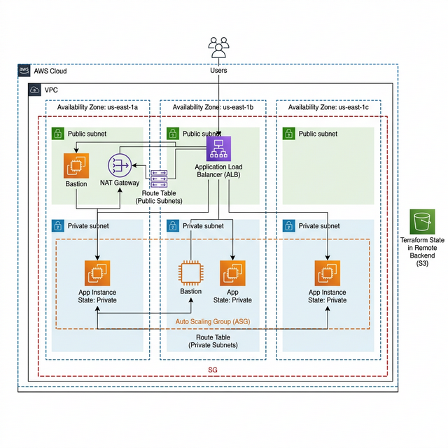

# AWS Multi-AZ Infrastructure with Terraform

Terraform example of a three-AZ AWS VPC with an internet-facing Application Load Balancer, EC2 Auto Scaling Group in private subnets, and nginx bootstrapped on Ubuntu. This is a **portfolio/reference deployment**, not a production certification.



## What it provisions

| Area | Implementation |
| --- | --- |
| Network | VPC, three public and three private subnets across configured AZs, internet gateway |
| Egress | **One NAT gateway** in the first AZ, shared by private subnets |
| Ingress | Public Application Load Balancer with **HTTP port 80 only** |
| Compute | Ubuntu 22.04 EC2 launch template, private ASG, nginx user data |
| Scaling | CPU target tracking; default minimum 2, desired 3, maximum 6 |
| Access | SSM instance profile; no inbound SSH security-group rule |
| State | Existing S3 backend with native S3 lockfile |
| Checks | GitHub Actions formatting and static validation |

The single NAT gateway is an intentional cost/availability trade-off: an outage of its AZ can affect egress from all private subnets. HTTP is **unencrypted** and suitable only for non-sensitive demonstrations. For production, add TLS, certificates, appropriate logging/monitoring, and a resilient egress design.

## Prerequisites

- Terraform **1.10 or newer** (required for `use_lockfile`)
- AWS CLI and credentials for an AWS account where you are authorized to create resources
- An existing, private, versioned, encrypted S3 state bucket with appropriate state and lock-object permissions
- Sufficient AWS budget for NAT, ALB, EC2, EBS and network traffic

> **Important:** `providers.tf` currently references an existing S3 bucket named `namra-terraform-state` and key `production/terraform.tfstate`. This configuration may point to real state. Do **not** initialize against it unless you own it and intend to manage that infrastructure. Use a separate backend bucket/key for a new independent deployment.

## Static checks (no AWS resources created)

```bash
terraform fmt -check -recursive
terraform init -backend=false -input=false
terraform validate
```

GitHub Actions runs the same checks on pull requests. A passing static check does not prove deployment success.

## Configuration

Copy `terraform.tfvars.example` to `terraform.tfvars` and review every value. The example file is tracked; the local `terraform.tfvars` file is ignored.

By default `ami_id = ""` resolves the latest matching Canonical Ubuntu 22.04 LTS x86_64 image in the configured region. Pin a reviewed AMI ID for repeatable deployments. Default ASG sizes are **2 / 3 / 6** (minimum / desired / maximum).

Availability Zones and subnet CIDR arrays must have matching lengths. Defaults target `us-east-1`; customize all region-specific settings together.

## Plan and deploy (only after review)

```bash
aws sts get-caller-identity
terraform init
terraform plan
# Run only with explicit approval, correct state, and an understood cost estimate:
terraform apply
```

The ALB DNS name and URL are available through:

```bash
terraform output -raw alb_dns_name
terraform output -raw alb_url
```

The nginx bootstrap serves the default page at `/`. The project does **not** currently install an `/api/status` endpoint, so do not use older endpoint-based examples as a test of load balancing. Validate the ALB target health and ASG instance membership in AWS before claiming distribution or failover was tested.

## Modules

```text
.
├── main.tf
├── providers.tf
├── variables.tf
├── outputs.tf
├── terraform.tfvars.example
├── modules/
│   ├── vpc/
│   ├── security_groups/
│   ├── alb/
│   ├── ec2/
│   └── autoscaling/
├── docs/OPERATIONS.md
└── .github/workflows/terraform-checks.yml
```

## Validation status and limitations

This repository includes source review and static CI checks, but no evidence in this branch of a fresh live AWS deployment, AZ failure exercise, load test, or measured cost comparison. These results should be recorded only after testing. See [Operations and validation](docs/OPERATIONS.md) for acceptance checks, failure-domain caveats, backend precautions, and safe destruction guidance.

## Cleanup

`terraform destroy` can permanently remove infrastructure and must only be run after checking account, state and plan. The existing remote-state bucket is outside this configuration and is not deleted by Terraform.
